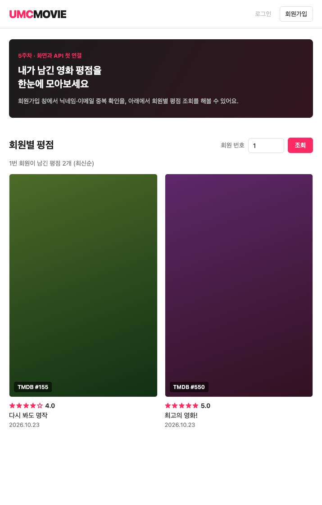
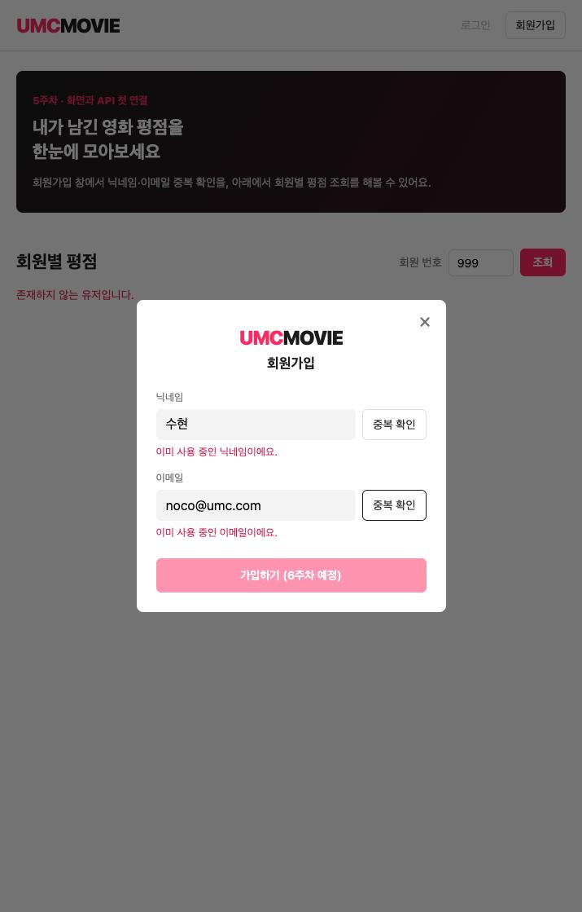
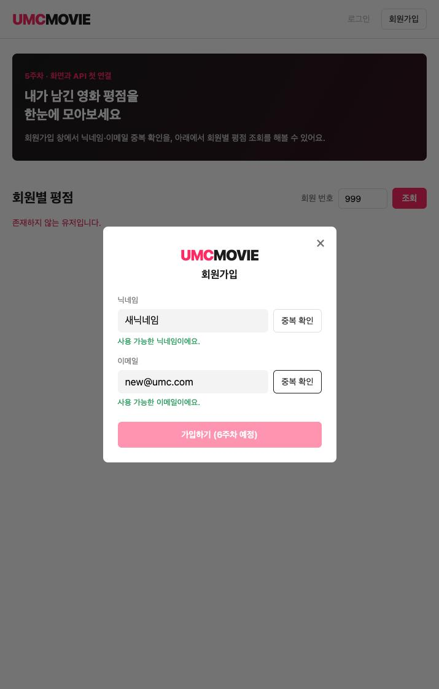

# 5주차 미션 기록 - 화면과 API를 처음 연결하기

- 스택: **Spring Boot 3.5.0** (Java 21, MySQL 8.0)
- 백엔드: `http://localhost:8080`
- 프론트(직접 만든 웹 화면): `http://localhost:5173` (HTML + JS, `npx serve -l 5173`)

---

## 1. 진행 과정

1. 로컬 MySQL에 `umc_movie` DB를 만들고 `member`, `rating`, `favorite` 테이블과 시드 데이터를 넣었다.
2. Spring Boot 새 프로젝트를 만들고 Boot 버전을 3.5.0으로 고정했다. `application.yml`에 DB 정보를 쓰고(`ddl-auto: validate`), 비밀번호는 환경 변수 `DB_PASSWORD`로 뺐다.
3. 레이어 기준 패키지(controller / service / repository / entity / dto)를 만들었다.
4. **[실습 0]** 간이 프론트(5173)에서 8080을 호출해 CORS 에러를 직접 확인했다.
   - `Access to fetch at 'http://localhost:8080/members/nickname/noco' from origin 'http://localhost:5173' has been blocked by CORS policy: No 'Access-Control-Allow-Origin' header is present on the requested resource.`
5. `BaseTimeEntity`, `Member`, `Rating` 엔티티와 Repository, DTO를 작성했다. `ddl-auto: validate`로 서버를 띄워 스키마 검증을 통과했다.
6. **[실습 1~3]** 닉네임/이메일 중복 체크, 유저별 평점 조회 API를 구현하고 Postman으로 확인했다.
7. **[실습 9]** `WebConfig`로 `http://localhost:5173` 출처를 허용했다. 같은 간이 프론트에서 정상 응답(`{"available":true}`)을 확인했다.
8. **[미션]** 영화 평점 서비스 화면(왓챠피디아 오마주)을 직접 만들고 API 3개를 모두 연결했다.

---

## 2. 핵심 코드

### Entity

```java
// entity/BaseTimeEntity.java
@Getter
@MappedSuperclass
public abstract class BaseTimeEntity {

    @CreationTimestamp
    @Column(name = "created_at", nullable = false, updatable = false)
    private LocalDateTime createdAt;

    @UpdateTimestamp
    @Column(name = "updated_at", nullable = false)
    private LocalDateTime updatedAt;
}
```

```java
// entity/Member.java
@Entity
@Table(name = "member")
@Getter
@NoArgsConstructor(access = AccessLevel.PROTECTED)
public class Member extends BaseTimeEntity {

    @Id
    @GeneratedValue(strategy = GenerationType.IDENTITY)
    @Column(name = "member_id")
    private Long memberId;

    @Column(nullable = false, unique = true, length = 254)
    private String email;

    @Column(nullable = false, length = 60)
    private String password;

    @Column(nullable = false, unique = true, length = 50)
    private String nickname;

    public Member(String email, String password, String nickname) {
        this.email = email;
        this.password = password;
        this.nickname = nickname;
    }
}
```

```java
// entity/Rating.java
@Entity
@Table(name = "rating", uniqueConstraints = @UniqueConstraint(columnNames = {"member_id", "movie_id"}))
@Getter
@NoArgsConstructor(access = AccessLevel.PROTECTED)
public class Rating extends BaseTimeEntity {

    @Id
    @GeneratedValue(strategy = GenerationType.IDENTITY)
    @Column(name = "rating_id")
    private Long ratingId;

    @ManyToOne(fetch = FetchType.LAZY)
    @JoinColumn(name = "member_id", nullable = false)
    private Member member;

    @Column(name = "movie_id", nullable = false)
    private Long movieId;

    @Column(nullable = false, columnDefinition = "TINYINT")
    private Integer score;

    @Column(columnDefinition = "TEXT")
    private String comment;
}
```

### DTO

```java
public record NicknameCheckResponse(boolean available) {}
public record EmailCheckResponse(boolean available) {}

public record RatingResponse(
        Long ratingId, Long movieId, Integer score, String comment,
        LocalDateTime createdAt, LocalDateTime updatedAt
) {
    public static RatingResponse from(Rating rating) {
        return new RatingResponse(
                rating.getRatingId(), rating.getMovieId(), rating.getScore(),
                rating.getComment(), rating.getCreatedAt(), rating.getUpdatedAt()
        );
    }
}
```

### Repository

```java
public interface MemberRepository extends JpaRepository<Member, Long> {
    boolean existsByNickname(String nickname);
    boolean existsByEmail(String email);
}

public interface RatingRepository extends JpaRepository<Rating, Long> {
    List<Rating> findByMember_MemberIdOrderByRatingIdDesc(Long memberId);
}
```

### Service

```java
// service/MemberService.java
@Service
@RequiredArgsConstructor
public class MemberService {

    private final MemberRepository memberRepository;

    @Transactional(readOnly = true)
    public NicknameCheckResponse checkNickname(String nickname) {
        boolean exists = memberRepository.existsByNickname(nickname);
        return new NicknameCheckResponse(!exists);
    }

    @Transactional(readOnly = true)
    public EmailCheckResponse checkEmail(String email) {
        boolean exists = memberRepository.existsByEmail(email);
        return new EmailCheckResponse(!exists);
    }
}
```

```java
// service/RatingService.java
@Service
@RequiredArgsConstructor
public class RatingService {

    private final RatingRepository ratingRepository;
    private final MemberRepository memberRepository;

    @Transactional(readOnly = true)
    public List<RatingResponse> getRatingsByMember(Long memberId) {
        if (!memberRepository.existsById(memberId)) {
            throw new ResponseStatusException(HttpStatus.NOT_FOUND, "존재하지 않는 유저입니다.");
        }
        return ratingRepository.findByMember_MemberIdOrderByRatingIdDesc(memberId).stream()
                .map(RatingResponse::from)
                .toList();
    }
}
```

### Controller

```java
// controller/MemberController.java
@RestController
@RequiredArgsConstructor
@RequestMapping("/members")
public class MemberController {

    private final MemberService memberService;

    @GetMapping("/nickname/{nickname}")
    public NicknameCheckResponse checkNickname(@PathVariable String nickname) {
        return memberService.checkNickname(nickname);
    }

    @GetMapping("/email/{email}")
    public EmailCheckResponse checkEmail(@PathVariable String email) {
        return memberService.checkEmail(email);
    }
}
```

```java
// controller/RatingController.java
@RestController
@RequiredArgsConstructor
@RequestMapping("/members")
public class RatingController {

    private final RatingService ratingService;

    @GetMapping("/{memberId}/ratings")
    public List<RatingResponse> getMemberRatings(@PathVariable Long memberId) {
        return ratingService.getRatingsByMember(memberId);
    }
}
```

### CORS 설정

```java
// config/WebConfig.java
@Configuration
public class WebConfig implements WebMvcConfigurer {

    @Override
    public void addCorsMappings(CorsRegistry registry) {
        registry.addMapping("/**")
                .allowedOrigins("http://localhost:5173")
                .allowedMethods("GET", "POST", "PATCH", "DELETE")
                .allowedHeaders("*");
    }
}
```

### 프론트에서 API 호출 (movie-frontend/api.js)

```js
const API_BASE = "http://localhost:8080";

async function request(path) {
  const res = await fetch(API_BASE + path);
  const body = await res.json().catch(() => null);
  if (!res.ok) {
    const error = new Error(body?.message || `요청 실패 (${res.status})`);
    error.status = res.status;
    throw error;
  }
  return body;
}

export const checkNickname = (nickname) => request(`/members/nickname/${encodeURIComponent(nickname)}`);
export const checkEmail = (email) => request(`/members/email/${encodeURIComponent(email)}`);
export const getMemberRatings = (memberId) => request(`/members/${encodeURIComponent(memberId)}/ratings`);
```

---

## 3. Postman 확인

> 📸 직접 캡처해서 넣기 (요청 URL + 응답 JSON이 한 화면에 보이게)

| API | 요청 | 응답 |
|---|---|---|
| 닉네임 중복 체크 | `GET /members/nickname/수현` | `{"available": false}` |
| 닉네임 중복 체크 | `GET /members/nickname/noco` | `{"available": true}` |
| 이메일 중복 체크 | `GET /members/email/noco@umc.com` | `{"available": false}` |
| 이메일 중복 체크 | `GET /members/email/new@umc.com` | `{"available": true}` |
| 유저별 평점 조회 | `GET /members/1/ratings` | 평점 2건, ratingId 2 → 1 (최신순) |
| 유저별 평점 조회 | `GET /members/999/ratings` | 404 Not Found |

---

## 4. 실제 화면에서 확인하기 (필수 미션)

CORS 설정 후, 직접 만든 웹 화면(`http://localhost:5173`)에서 구현한 API 3개를 모두 호출해 정상 응답을 받았다.

**유저별 평점 조회** `GET /members/1/ratings` → 최신순 2건 표시



**유저별 평점 조회 - 없는 회원** `GET /members/999/ratings` → 404 → "존재하지 않는 유저입니다."


**닉네임/이메일 중복 체크 - 이미 사용 중** `수현`, `noco@umc.com` → `available: false`



**닉네임/이메일 중복 체크 - 사용 가능** `새닉네임`, `new@umc.com` → `available: true`



---

## 5. 트러블 슈팅

### ⚡ 이슈 No.1

**`이슈`**

👉 IntelliJ에서 서버를 실행하자 `APPLICATION FAILED TO START` / `Web server failed to start. Port 8080 was already in use.`가 발생했다.

**`문제`**

👉 앞서 터미널에서 `./gradlew bootRun`으로 띄운 서버가 종료되지 않고 백그라운드에서 8080 포트를 계속 점유하고 있었다.

**`해결`**

👉 `lsof -nP -iTCP:8080 -sTCP:LISTEN`으로 8080을 점유한 프로세스(java)를 찾아 종료한 뒤, IntelliJ에서 다시 실행했다.

### ⚡ 이슈 No.2

**`이슈`**

👉 터미널 `mysql` 클라이언트로 시드 데이터를 조회하자 한글 닉네임과 코멘트가 `??`로 표시됐다.

**`문제`**

👉 데이터는 정상 저장되어 있었고(`HEX(nickname)`으로 확인하니 UTF-8 바이트가 맞았다), 클라이언트 접속 문자셋이 맞지 않아 화면에만 깨져 보였다.

**`해결`**

👉 `mysql --default-character-set=utf8mb4`로 접속하자 한글이 정상 표시됐다. API 응답에서도 한글이 정상으로 나왔다.
